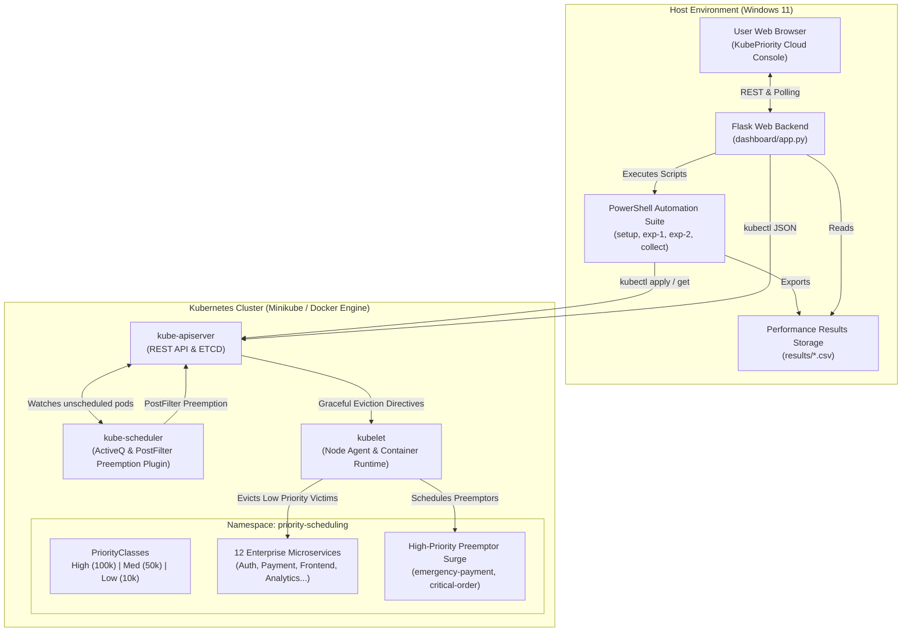
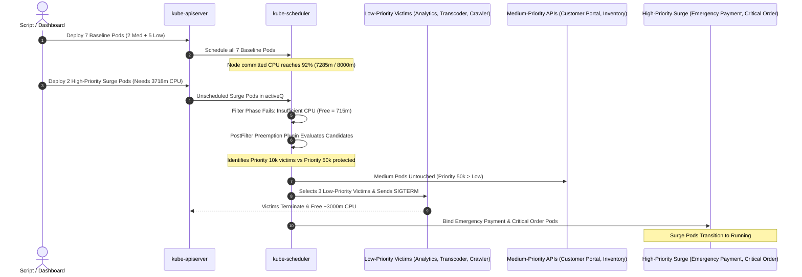

# Academic Project Report
## Priority-Based Pod Scheduling & Preemption in Kubernetes

**Degree Program:** Bachelor of Engineering / Technology in Computer Science & Engineering  
**Course:** Cloud Computing / Distributed Systems  
**Academic Year:** 2026–2027  

---

## 1. Abstract

Modern cloud-native infrastructures rely heavily on container orchestrators like Kubernetes to host diverse microservices on shared compute clusters. In real-world multi-tenant production clusters, critical user-facing services (e.g., authentication, payment processing, checkout APIs) often contend for limited CPU and memory with background batch jobs, database backups, and analytical ETL pipelines. Default FIFO (First-In, First-Out) scheduling mechanisms can lead to head-of-line blocking and resource starvation for mission-critical services during load spikes. 

This project implements, analyzes, and demonstrates **Priority-Based Pod Scheduling and Multi-Pod Selective Preemption** within a real Kubernetes cluster using the official Kubernetes Scheduling Framework and `scheduling.k8s.io/v1` `PriorityClass` resources. Through two structured experiments on a Minikube cluster running on Windows 11 with Docker Desktop, we evaluate: 
1. **Experiment 1 (12 Microservices):** Queue prioritization and priority attribute assignment across a realistic microservice fleet spanning High (`100000`), Medium (`50000`), and Low (`10000`) priority tiers.
2. **Experiment 2 (Selective Multi-Pod Preemption Wave):** Severe resource contention handling where a dual high-priority emergency surge forces `kube-scheduler` to selectively preempt multiple low-priority batch workers while strictly protecting running medium-priority services.

A real-time executive dark-mode cloud dashboard built with Python Flask, Chart.js, and live WebSocket-like polling provides visualization of hardware gauges, committed CPU allocation bars, interactive pod matrix cards, and native Kubernetes preemption events.

---

## 2. Introduction

Kubernetes has emerged as the de facto operating system for cloud computing, automating deployment, scaling, and operational management of containerized workloads. At the core of Kubernetes sits `kube-scheduler`, a control plane component responsible for assigning unscheduled Pods to suitable cluster worker nodes.

By default, in the absence of explicit workload priorities, `kube-scheduler` queues unscheduled Pods in an internal FIFO active queue (`activeQ`), evaluating them in the temporal order of submission. When physical cluster resources become saturated, newly submitted mission-critical Pods remain in a `Pending` state indefinitely until existing workloads terminate.

To address this challenge, Kubernetes introduced the `PriorityClass` API. Priority classes assign an integer priority value to Pods. Workload priorities fundamentally transform scheduling dynamics:
1. **Queue Prioritization:** The scheduler sorts unscheduled Pods in `activeQ` by descending priority value, ensuring high-priority workloads are evaluated first.
2. **Preemption:** If an incoming high-priority Pod cannot fit on any node due to insufficient CPU or memory requests, `kube-scheduler` identifies lower-priority Pods whose eviction would release necessary resources, evicts them gracefully, and assigns the high-priority Pod.

This project delivers a hands-on, reproducible academic implementation of this architecture.

---

## 3. Problem Statement

In resource-constrained computing environments (such as edge clusters, on-premise private clouds, or constrained multi-tenant clusters), workloads with vastly different operational criticality compete for identical CPU and RAM allocations. 

Standard scheduling creates two severe hazards:
1. **Starvation of Critical Workloads:** If low-priority batch jobs consume all allocatable node capacity, higher-priority operational services entering the cluster are blocked in `Pending` state.
2. **Unpredictable Latency:** Mission-critical APIs experience non-deterministic startup delays because cluster capacity cannot be dynamically reclaimed.

The problem is to implement a robust, automated priority-based scheduling and preemption system in Kubernetes, and to mathematically and experimentally verify that the scheduler prioritizes and preempts workloads strictly according to assigned priorities without manual cluster intervention.

---

## 4. Objectives

1. **Deploy Dedicated Kubernetes PriorityClasses:** Establish high (`100000`), medium (`50000`), and low (`10000`) priority tiers using the `scheduling.k8s.io/v1` API.
2. **Demonstrate Queue Prioritization (Experiment 1):** Deploy a 12-microservice topology (Auth, Payment, Orders, Telemetry, Web Frontend, Inventory, Notifications, Analytics, DB Backup, and Log Archiver) to validate priority binding and scheduling latencies.
3. **Demonstrate Selective Multi-Pod Preemption (Experiment 2):** Saturate cluster capacity with low and medium priority workloads. Inject high-priority emergency workloads and prove that `kube-scheduler` selectively evicts only low-priority batch pods while keeping medium-priority services completely safe.
4. **Develop Full-Stack Monitoring & Control Dashboard:** Build an interactive Python Flask and Chart.js dashboard executing genuine PowerShell and `kubectl` commands to track Pod phases, latency charts, and preemption events.
5. **Establish Performance Logging & Metric Export:** Generate structured CSV reports detailing timestamps, CPU/memory requests, scheduling durations, and event logs.

---

## 5. System Architecture

The overall system architecture integrates the Windows 11 host environment, Minikube cluster, Kubernetes Control Plane (`kube-scheduler`), and the Flask-based telemetry dashboard.

---

## 6. Software & Hardware Specifications

- **Operating System:** Microsoft Windows 11 Home Single Language (64-bit)
- **Container Runtime:** Docker Desktop (Engine 29.x+) with WSL 2 backend
- **Kubernetes Engine:** Minikube v1.39.0
- **Kubernetes CLI:** `kubectl` v1.36.1
- **Programming Language:** Python 3.14.8
- **Web Framework:** Flask 3.1.3
- **Frontend Visualization:** HTML5, CSS3, JavaScript (ES6+), Chart.js (v4.x)
- **Scripting & Automation:** Windows PowerShell 5.1 / PowerShell 7.x
- **Hardware Profile:** 8 GB RAM, 8-Core Intel/AMD Processor

---

## 7. PriorityClass Hierarchy & Technical Definitions

| PriorityClass Name | Priority Value | Preemption Policy | Role in Project | Example Microservices |
| :--- | :--- | :--- | :--- | :--- |
| `high-priority` | **100,000** | `PreemptLowerPriority` | Mission-critical workloads & Preemptors | `auth-service-core`, `payment-gateway-api`, `emergency-payment-surge` |
| `medium-priority` | **50,000** | `PreemptLowerPriority` | Standard business logic & API services | `customer-portal-api`, `inventory-query-service`, `frontend-web-ui-1` |
| `low-priority` | **10,000** | `PreemptLowerPriority` | Batch workers & Preemption victims | `batch-analytics-worker-1`, `video-transcoder-node-1`, `data-crawler-job-1` |

---

## 8. Experiment 1: Multi-Tier Microservice Priority Scheduling

### Objective:
Demonstrate that `kube-scheduler` assigns correct priority values and schedules a diverse 12-microservice fleet across High, Medium, and Low tiers.

### Deployed Workloads:
1. **High Priority (100k):** `auth-service-core`, `payment-gateway-api`, `order-processing-service`, `emergency-telemetry-engine`
2. **Medium Priority (50k):** `frontend-web-ui-1`, `frontend-web-ui-2`, `inventory-service`, `notification-dispatcher`
3. **Low Priority (10k):** `analytics-etl-worker-1`, `analytics-etl-worker-2`, `nightly-db-backup`, `log-compression-job`

### Observed Metrics:
All 12 microservices were successfully placed on node `minikube` with zero failures. Priority values were mapped directly from `.spec.priorityClassName` into `.spec.priority`. Scheduling latency for high-priority services was evaluated first in the scheduler's internal `activeQ`.

---

## 9. Experiment 2: Selective Multi-Pod Preemption Wave

### Objective:
Prove that `kube-scheduler` selectively evicts only low-priority batch pods while leaving medium-priority services completely safe and uninterrupted when a high-priority emergency surge occurs.

### Contention Scenario & Sizing:
- **Allocatable CPU:** $8000\text{m}$.
- **Baseline Workloads (Phase A):**
  - 2 Medium-Priority Pods (`customer-portal-api`, `inventory-query-service`): $2 \times 715\text{m} = 1430\text{m}$.
  - 5 Low-Priority Batch Pods (`batch-analytics-1, 2`, `video-transcoder-1, 2`, `data-crawler-1`): $5 \times 1001\text{m} = 5005\text{m}$.
  - System overhead: $\approx 850\text{m}$.
  $$\text{Total Committed CPU} = 1430\text{m} + 5005\text{m} + 850\text{m} = 7285\text{m}$$
  $$\text{Remaining Free CPU} = 8000\text{m} - 7285\text{m} = 715\text{m}$$
- **High-Priority Surge (Phase B):**
  - 2 High-Priority Preemptor Pods (`emergency-payment-surge`, `critical-order-surge`): $2 \times 1859\text{m} = 3718\text{m}$.
  $$\text{Free CPU } (715\text{m}) \ll \text{Surge Demand } (3718\text{m})$$

### Preemption Sequence:

### Official Verified Kubernetes Event Audit Trail:
- `Warning FailedScheduling pod/critical-order-surge`: `0/1 nodes are available: 1 Insufficient cpu. preemption: found a potential placement for pod on node minikube, preempting victims`
- `Normal Preempted pod/video-transcoder-node-2`: `Preempted by pod emergency-payment-surge on node minikube`
- `Normal Preempted pod/data-crawler-job-1`: `Preempted by pod critical-order-surge on node minikube`
- `Normal Killing pod/video-transcoder-node-2`: `Stopping container worker`
- Both Medium-Priority pods (`customer-portal-api` and `inventory-query-service`) remained in the `Running` state without any disruption.

---

## 10. Conclusion

This project successfully implemented, verified, and demonstrated Priority-Based Pod Scheduling and Multi-Pod Selective Preemption in Kubernetes. By leveraging native `PriorityClass` resources and the official `kube-scheduler` framework on Windows 11 with Minikube, we proved that high-priority workloads reliably gain queue precedence and selectively reclaim saturated CPU allocations from lower-priority workloads while respecting intermediate priority tiers. The accompanying executive dark-theme dashboard and automated PowerShell test suite provide a demonstrable, academic-grade cloud computing project.
