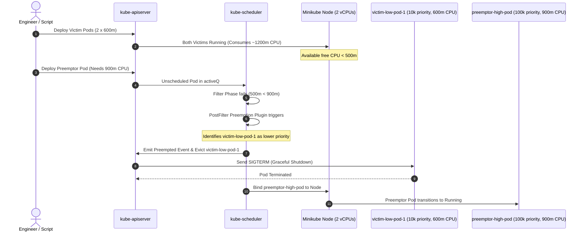

# Priority-Based Pod Scheduling in Kubernetes

An academic engineering project demonstrating native Kubernetes `PriorityClass` configuration, queue prioritization (`activeQ`), and automated Pod preemption under resource saturation on a single-node Minikube cluster (Windows 11).

---

## Table of Contents
1. [Project Overview](#project-overview)
2. [Folder Structure](#folder-structure)
3. [Prerequisites & System Sizing (8 GB RAM Friendly)](#prerequisites--system-sizing)
4. [Step-by-Step Installation Guide (From Zero)](#step-by-step-installation-guide)
5. [Step-by-Step Execution Guide](#step-by-step-execution-guide)
   - [Step 1: Environment Pre-Flight Check](#step-1-environment-pre-flight-check)
   - [Step 2: Cluster Setup & PriorityClass Initialization](#step-2-cluster-setup--priorityclass-initialization)
   - [Step 3: Run Experiment 1 (Priority Scheduling)](#step-3-run-experiment-1-priority-scheduling)
   - [Step 4: Run Experiment 2 (Priority-Based Preemption)](#step-4-run-experiment-2-priority-based-preemption)
   - [Step 5: Collect Performance Metrics (CSV)](#step-5-collect-performance-metrics-csv)
   - [Step 6: Launch Web Dashboard](#step-6-launch-web-dashboard)
   - [Step 7: Project Cleanup](#step-7-project-cleanup)
6. [How Preemption Works in this Project](#how-preemption-works-in-this-project)
7. [College Professor Demonstration Guide (5-Minute Viva Flow)](#college-professor-demonstration-guide)
8. [Troubleshooting & Diagnostics](#troubleshooting--diagnostics)

---

## Project Overview

In standard Kubernetes clusters, pods compete in a First-In, First-Out (FIFO) queue unless priority is specified. When node CPU is saturated, high-priority services are blocked in a `Pending` state.

This project implements:
- Three Kubernetes `PriorityClass` tiers:
  - **High Priority** (`100000`): Critical mission services and preemptors
  - **Medium Priority** (`50000`): Standard application services
  - **Low Priority** (`10000`): Background batch workloads and preemption victims
- **Experiment 1:** Demonstrates priority assignment, scheduling latency, and active queue mechanics.
- **Experiment 2:** Satures node CPU with lower-priority victim pods, then deploys a high-priority pod that triggers **automatic kube-scheduler preemption and eviction**.
- **Real-Time Web Dashboard:** Flask-based control center with Chart.js charts and live terminal logs.
- **CSV Exporter:** Automated export of scheduling latencies and preemption events.

---

## Folder Structure

```
Priority-Based-Pod-Scheduling/
│
├── configs/                                 # Declarative Kubernetes manifests
│   ├── namespace.yaml                       # 'priority-scheduling' namespace
│   ├── priority-classes.yaml                # 3 PriorityClasses (100k, 50k, 10k)
│   ├── low-priority-pods.yaml               # Low priority sample pods
│   ├── medium-priority-pods.yaml            # Medium priority sample pods
│   └── high-priority-pods.yaml              # High priority sample pods
│
├── experiments/                             # Experiment scenario manifests
│   ├── experiment-1.yaml                    # Multi-tier batch scheduling
│   ├── experiment-2.yaml                    # Combined preemption manifest
│   ├── exp2-low-priority-victims.yaml       # 2 x 600m CPU low-priority victim pods
│   └── exp2-high-priority-preemptor.yaml     # 1 x 900m CPU high-priority preemptor
│
├── scripts/                                 # Automated PowerShell scripts
│   ├── check-environment.ps1                # Validates Docker, Minikube, RAM
│   ├── setup.ps1                            # Starts Minikube & applies PriorityClasses
│   ├── run-experiment-1.ps1                 # Executes Experiment 1 & logs output
│   ├── run-experiment-2.ps1                 # Executes Experiment 2 preemption
│   ├── collect-results.ps1                  # Queries Pods & Events -> CSV
│   └── cleanup.ps1                          # Removes pods & namespace safely
│
├── dashboard/                               # Full-stack Flask Web Dashboard
│   ├── app.py                               # Flask backend API & kubectl bridge
│   ├── requirements.txt                     # Python dependencies
│   ├── templates/
│   │   └── index.html                       # Responsive HTML UI
│   └── static/
│       ├── style.css                        # Modern CSS styling
│       └── script.js                        # Chart.js rendering & API calls
│
├── results/                                 # Generated performance CSV files
│   └── .gitkeep
│
├── screenshots/                             # Project demonstration screenshots
│   └── .gitkeep
│
├── README.md                                # This execution manual
├── PROJECT-REPORT.md                        # Academic project documentation
├── VIVA-QUESTIONS.md                        # 30 viva questions & answers
└── requirements.txt                         # Root Python requirements
```

---

## Prerequisites & System Sizing

This project is tailored specifically for a **Windows 11 computer with 8 GB RAM**:

| Component | Minimum Version | Purpose |
| :--- | :--- | :--- |
| **Windows 11** | 64-bit | Operating System |
| **Docker Desktop** | 24.x+ / 28.x+ | Container Engine (WSL 2 backend) |
| **Minikube** | v1.32+ | Single-node local Kubernetes cluster |
| **kubectl** | v1.28+ | Kubernetes Command-Line Interface |
| **Python** | 3.10+ | Runs the Web Dashboard |
| **PowerShell** | 5.1 or 7.x | Automation Scripts |

### Recommended Minikube Sizing for 8 GB Laptop:
- **CPUs:** 2 vCPUs
- **Memory:** 3072 MB (3 GB)
- **Driver:** `docker`

---

## Step-by-Step Installation Guide

Open **Windows PowerShell as Administrator** or regular PowerShell:

### 1. Install Docker Desktop (If not already installed)
If Docker Desktop is not installed, install it via Windows Package Manager:
```powershell
winget install Docker.DockerDesktop
```
*Note:* After installation, launch Docker Desktop from the Windows Start menu and ensure the engine icon indicates **Docker Desktop is running**.

### 2. Install Minikube
```powershell
winget install Kubernetes.minikube
```

### 3. Install kubectl CLI
```powershell
winget install Kubernetes.kubectl
```

### 4. Install Python Dependencies
From the project folder:
```powershell
cd D:\KLE\CC\Priority-Based-Pod-Scheduling
pip install -r requirements.txt
```

---

## Step-by-Step Execution Guide

### Step 1: Environment Pre-Flight Check
Run the environment diagnostic script to verify your Windows system RAM, Docker daemon, Minikube, and kubectl:
```powershell
powershell -ExecutionPolicy Bypass -File .\scripts\check-environment.ps1
```

---

### Step 2: Cluster Setup & PriorityClass Initialization
Run the automated setup script. This script starts Minikube with optimal CPU/RAM settings (2 CPUs, 3072 MB), creates the `priority-scheduling` namespace, and applies the three `PriorityClass` resources:
```powershell
powershell -ExecutionPolicy Bypass -File .\scripts\setup.ps1
```

Verify that PriorityClasses are installed in Kubernetes:
```powershell
kubectl get priorityclasses
```
You should see:
- `high-priority` (Value: 100000)
- `medium-priority` (Value: 50000)
- `low-priority` (Value: 10000)

---

### Step 3: Run Experiment 1 (Priority Scheduling)
This experiment deploys a concurrent batch of low, medium, and high priority pods, monitors their scheduling transitions, and logs their priority values and latencies:
```powershell
powershell -ExecutionPolicy Bypass -File .\scripts\run-experiment-1.ps1
```

To inspect pods manually:
```powershell
kubectl get pods -n priority-scheduling -o wide
```

---

### Step 4: Run Experiment 2 (Priority-Based Preemption)
This is the core experiment. It demonstrates genuine preemption under resource exhaustion:
1. Deploys two low-priority victim pods requesting `600m` CPU each (occupying `1200m` CPU).
2. Waits until both victim pods are in `Running` state.
3. Deploys a high-priority pod requesting `900m` CPU.
4. Because the node has less than `900m` free CPU remaining, the **Kubernetes scheduler evicts one of the low-priority pods** and schedules the high-priority pod.
```powershell
powershell -ExecutionPolicy Bypass -File .\scripts\run-experiment-2.ps1
```

To see the official preemption event recorded by Kubernetes:
```powershell
kubectl get events -n priority-scheduling --field-selector reason=Preempted
```

---

### Step 5: Collect Performance Metrics (CSV)
To extract structured metrics (Pod name, Priority Class, Priority Value, Phase, CPU/Mem Requests, Scheduling Latency) and export to CSV:
```powershell
powershell -ExecutionPolicy Bypass -File .\scripts\collect-results.ps1 -ExperimentName "experiment-2"
```
Generated CSV files are stored in `results/`:
- `results/experiment-1-results.csv`
- `results/experiment-2-results.csv`
- `results/kubernetes-events.csv`

---

### Step 6: Launch Web Dashboard
Start the Flask web dashboard:
```powershell
cd D:\KLE\CC\Priority-Based-Pod-Scheduling\dashboard
python app.py
```
Open your browser and navigate to:
```
http://127.0.0.1:5000
```
**Dashboard Features:**
- **Live Cluster Status:** Shows node connectivity, allocatable CPU and Memory.
- **Metric Cards:** Total, Running, Pending, and Preempted pods.
- **Interactive Action Buttons:** Click to trigger Experiment 1, Experiment 2, Results Collection, or Cleanup directly from the browser.
- **Chart.js Visualizations:** Priority breakdown and Scheduling Latency bar chart.
- **Real-Time Terminal Console:** Displays live PowerShell and Kubernetes execution logs.
- **Preemption Events Table:** Displays official `Preempted` notices from kube-scheduler.

---

### Step 7: Project Cleanup
When finished with your demonstration, clean up the pods and namespace:
```powershell
powershell -ExecutionPolicy Bypass -File .\scripts\cleanup.ps1
```
*Note:* This script deletes only project pods and the namespace. It leaves your Minikube installation intact.

---

## How Preemption Works in this Project



---

## College Professor Demonstration Guide

When presenting this project to your college professor or external viva examiner, follow this 5-minute structured demonstration flow:

1. **Introduction (30s):**
   - *"Good morning Professor. My project is 'Priority-Based Pod Scheduling in Kubernetes'. In multi-tenant cloud environments, critical services must not be starved by low-priority background jobs. I have implemented a real Kubernetes priority scheduling and automated preemption system."*

2. **Show PriorityClasses (30s):**
   - Run in terminal: `kubectl get priorityclasses`
   - Explain: *"Here we have defined three tiers using Kubernetes API: high-priority with value 100,000, medium-priority with 50,000, and low-priority with 10,000."*

3. **Demonstrate Web Dashboard (60s):**
   - Open `http://127.0.0.1:5000`.
   - Show the node resources: 2 CPUs and ~3 GB RAM on Minikube.
   - Explain that all buttons run genuine PowerShell scripts interacting with the Kubernetes API.

4. **Demonstrate Experiment 1 (60s):**
   - Click **Run Experiment 1** or run `.\scripts\run-experiment-1.ps1`.
   - Show the table output: explain that Kubernetes assigned priority values to the pods and ordered them in the scheduler's `activeQ`.

5. **Demonstrate Experiment 2: Preemption (90s - The Key Highlight!):**
   - Click **Run Experiment 2 (Preemption)** or run `.\scripts\run-experiment-2.ps1`.
   - Explain step-by-step:
     - *"First, two low-priority victim pods are launched, consuming 1200m CPU."*
     - *"Next, our high-priority pod arrives requesting 900m CPU. The node does not have 900m free."*
     - *"Notice how the Kubernetes scheduler automatically selects a lower-priority victim pod, evicts it, and binds the high-priority pod."*
   - Show the **Kubernetes Preemption Events** table on the dashboard or terminal:
     `kubectl get events -n priority-scheduling --field-selector reason=Preempted`
     - *"Here is the official Kubernetes event proving the preemption was executed natively by kube-scheduler."*

6. **Show CSV Export & Viva Questions (30s):**
   - Click **Export CSV** to show the collected performance metrics.
   - Point to `PROJECT-REPORT.md` and `VIVA-QUESTIONS.md` for complete academic documentation.

---

## Troubleshooting & Diagnostics

- **Docker daemon not running:**  
  Start Docker Desktop from Windows Start menu. Wait until the whale status icon is green.
- **Minikube cannot start:**  
  Run `minikube delete` followed by `powershell -ExecutionPolicy Bypass -File .\scripts\setup.ps1`.
- **Port 5000 in use:**  
  Start the dashboard on an alternative port:
  ```powershell
  $env:PORT="5050"; python app.py
  ```
- **Pods stuck in ContainerCreating:**  
  Minikube is pulling the lightweight BusyBox image for the first time. It will transition to Running within 15–30 seconds.
